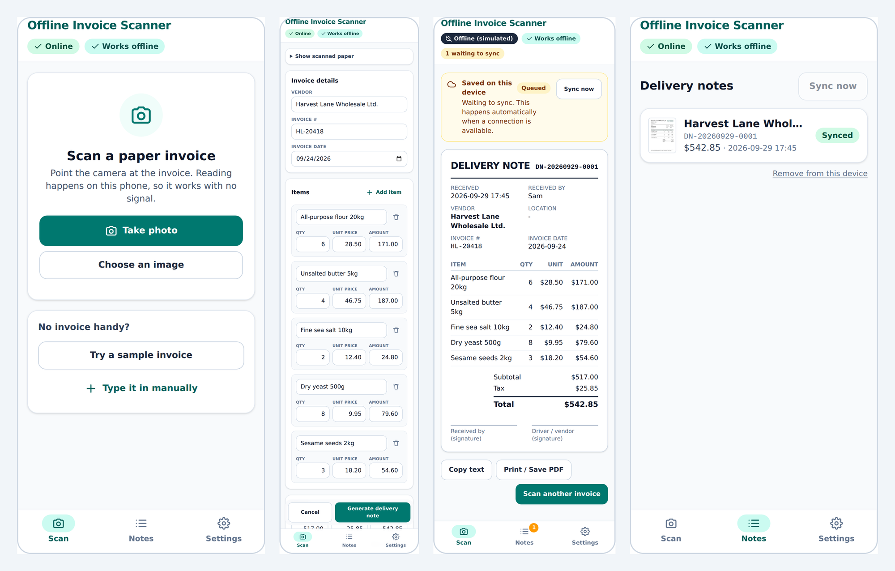
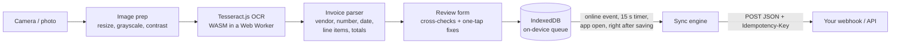

# Offline Invoice Scanner

**An installable web app that lets frontline staff turn a paper invoice into a clean digital delivery note, with no signal at all.** Point the phone at the invoice, the text is read on the device, the person confirms a pre-filled form, and the note is saved instantly. It syncs to your system on its own when the connection comes back.



<sub>Left to right: scan screen, the pre-filled review form, the note queued while offline, and the same note after it synced. All captured from the real build by `scripts/take-screenshots.mjs`.</sub>

> **Live demo:** _(added once deployed - see [Deploying](#deploying-the-demo-to-github-pages))_ · Tap **Try a sample invoice** to run the whole flow without a paper invoice. Then open **Settings → Simulate being offline** to watch notes queue and sync.

---

## The case study

**Problem.** Staff who receive deliveries in basements, loading docks and rural sites often have no signal, so the cloud ordering system is unreachable. They fall back to handwritten notes: slow, inconsistent from person to person, and hard to reconcile with the real records afterwards.

**Solution.** A lightweight app that installs to the phone's home screen (no app store, no IT setup) and runs entirely on the device. The camera image is read by an on-device OCR engine. The parsed vendor, invoice number, date, line items and totals land in an editable form, and the numbers are cross-checked so the person knows exactly where to look. One tap generates a formatted delivery note. Notes are stored in a local queue and sent automatically once a connection exists.

**Tools.** React 19, Vite, Tailwind CSS 4, TypeScript, Tesseract.js (WebAssembly OCR in a Web Worker), IndexedDB, and a service worker via `vite-plugin-pwa`.

**Result.** A handwritten, paper-only fallback replaced by a consistent digital record captured at the moment of delivery, with nothing to reconcile later and nothing that depends on a particular device, OS or connection. What this build demonstrably does (each point is covered by an automated test, see [Testing](#testing)):

- Opens, reads a photographed invoice and produces a note **with the web server shut down completely**.
- Reads the bundled sample invoice in about **2 seconds** (measured in headless Chromium on a cloud VM; phones vary).
- Makes **zero requests to third-party hosts**. The OCR engine and language data are served from the app's own origin, never a CDN.
- Never loses a note: the queue survives reloads, and a retried request can never create a duplicate on the server.

---

## How it works



**Working with no signal.** On first visit the service worker caches the app shell plus the OCR engine (about 4 MB) and the English language data (about 3 MB), roughly 7 MB in total. A status badge in the header shows *Preparing offline mode…* until that finishes, then *Works offline*, so nobody heads to the basement before the app is ready. The badge checks the actual cache contents rather than assuming.

**Reading the invoice.** The photo is downscaled (phone photos are 12+ megapixels; OCR gets slower, not better), converted to grayscale and contrast-stretched, then read by Tesseract's LSTM model. The text goes to a rule-based parser that finds the vendor (even when the company name and the word INVOICE share a line), invoice number, date (ISO, `Sep 27, 2026`, `25/09/2026`, and it flags genuinely ambiguous ones like `03/04/2026`), line items in several column layouts, subtotal, tax and total. It also repairs the usual OCR slips inside numbers (`S12.50`, `1O.50`, `12,50`).

**Trusting the result.** OCR is never perfect, so the form shows *why* something looks wrong instead of hiding it: "Line items add up to 358.00 but the subtotal says 400.00", with a one-tap *Set subtotal to 358.00*. A hard-to-read scan gets a warning banner. Manual entry is always available.

**Syncing safely.** Every note gets a unique id. The sync engine sends oldest first and, per note: a network failure stops the run and leaves everything queued; a 5xx / 408 / 429 keeps the note queued and retries later; a 4xx marks it *Needs attention* for a person to look at. Each request carries an `Idempotency-Key` header, so a request that succeeded but whose response was lost cannot create a duplicate on retry. Only one sync runs at a time.

### The sync payload

Each note is `POST`ed as JSON (`Content-Type: application/json`, header `Idempotency-Key: <id>`):

```json
{
  "source": "offline-invoice-scanner",
  "version": 1,
  "id": "0f6f1c3e-7b1e-4b0e-9d58-6b1f8f0f8c11",
  "noteNumber": "DN-20260929-0001",
  "createdAt": "2026-09-29T17:44:12.000Z",
  "receivedBy": "Sam",
  "location": "Downtown",
  "remarks": "",
  "invoice": {
    "vendor": "Harvest Lane Wholesale Ltd.",
    "invoiceNumber": "HL-20418",
    "invoiceDate": "2026-09-24",
    "items": [
      { "id": "…", "description": "All-purpose flour 20kg", "qty": 6, "unitPrice": 28.5, "amount": 171 }
    ],
    "subtotal": 517,
    "tax": 25.85,
    "total": 542.85
  }
}
```

By default the app syncs to a **built-in demo cloud** (a stand-in server inside the browser that behaves like a real one: unreachable while offline, takes a moment to answer, de-duplicates by id), so the demo works with no backend. In **Settings → Your webhook** you can point it at any HTTPS endpoint: n8n, Make, Zapier, or your own API. The endpoint must allow cross-origin requests from wherever the app is hosted (in n8n's Webhook node this is the *Allowed Origins (CORS)* option).

---

## Run it

Requires Node 20.19+ (22 recommended, see `.nvmrc`).

```bash
npm install          # also copies the OCR engine into public/ocr (postinstall)
npm run dev          # http://localhost:5173  (service worker is production-only)
npm run build        # type-check + production build with the service worker
npm run preview      # serve the production build on http://localhost:4173
```

To try it on a phone, run `npm run build && npm run preview -- --host`, open the address it prints from the phone on the same Wi-Fi (service workers, and therefore offline mode and installing, need HTTPS on a real device, so the [GitHub Pages demo](#deploying-the-demo-to-github-pages) is the easier route), then use *Add to Home Screen*.

## Testing

```bash
npm test             # 80+ unit / component / real-OCR tests (Vitest)
npm run test:e2e     # browser tests against the production build (Playwright + Chromium)
npm run ci           # everything CI runs: type-check, tests, build, e2e
```

What is covered, and why it is more than "the page loads":

| Layer | What it proves |
| --- | --- |
| Parser | Vendor / number / date / item / total extraction across column layouts, OCR-noise repair, ambiguous dates, empty and junk input never throws. |
| Validation | Line items vs subtotal vs tax vs total cross-checks and the one-tap fixes. |
| Queue + sync engine | Oldest-first sending, stop-on-network-error, 4xx vs 5xx handling, single-flight runs, idempotent demo server, webhook status-code mapping. The tests were checked by deliberately breaking the engine three ways and confirming they fail. |
| **Real OCR** | The actual Tesseract engine and bundled language model read both sample invoices (a clean scan and a rotated, shadowed, noisy "phone photo") and every field is parsed correctly. |
| Review form | Editing, decimals, auto-recalculation, warnings, disabled states. |
| **Offline, end to end** | Real browser: install, go offline, reload, scan a photo, generate a note, reload again, reconnect, and watch it sync exactly once. |
| **Dead server** | The web server process is shut down, then the app is reloaded, reads an invoice and queues a note, purely from the service worker cache. |
| No third parties | Every request during a scan stays on the app's own origin. |

The sample invoices are fictional. They are generated by `npm run make:samples`, along with the `docs/samples/` images.

## Deploying the demo to GitHub Pages

`.github/workflows/deploy.yml` builds with `BASE_PATH=/<repo>/` and publishes `dist/` on every push to `main`. One-time setup: **Settings → Pages → Build and deployment → Source: GitHub Actions**. The app also works at a domain root (leave `BASE_PATH` unset), and both configurations are covered by the end-to-end suite.

## Honest limitations

- **OCR accuracy depends on the photo.** The rule-based parser handles common invoice layouts, not every layout in the world, and it reads printed text only (no handwriting). That is why the review step exists. A production version would be tuned on the client's real invoices.
- **English only** out of the box. Other languages are a matter of adding their `traineddata` file.
- **Sync runs while the app is open** (and when it is reopened). It does not use the Background Sync API, which is unavailable on iOS Safari.
- **iOS storage:** Safari can clear a website's local data after about a week of not being used, unless the app is installed to the Home Screen. Installing it is recommended for real use.
- **No authentication** is built in. Point the webhook at an endpoint you control and add a secret in its URL or a gateway in front.
- The **demo cloud is simulated**, so it only proves the client-side behaviour. Swap in your webhook to test against a real system.

## Project layout

```
src/
  lib/          ocr.ts · image.ts · parse.ts · money.ts (validation) · note.ts
                db.ts (IndexedDB queue) · sync.ts (engine) · transports.ts (demo + webhook)
                offlineReady.ts · settings.ts
  components/   CaptureStep · ReviewForm · NoteView · NotesList · SettingsPanel · ScanFlow
  hooks/        useNotes · useConnectivity
scripts/        copy-ocr-assets · make-icons · make-samples · take-screenshots
tests/          Vitest unit, component and real-OCR tests
e2e/            Playwright offline / dead-server / sync tests
```

## License

MIT
